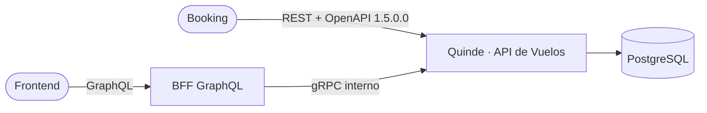

# gRPC interno

Además de REST, la API puede abrir un servidor gRPC interno con su contrato en Protobuf
([`contracts/proto/flights/v1/flights.proto`](../contracts/proto/flights/v1/flights.proto),
paquete `quinde.flights.v1`). Lo va a consumir el BFF GraphQL de la fase siguiente.

REST y el contrato OpenAPI 1.5.0.0 no cambian: siguen siendo el contrato público para el Booking.
gRPC está **apagado por defecto** (`GRPC_ENABLED=false`): con la variable sin definir o en `false`
no se abre ningún puerto y la API se comporta igual que antes.

## Por qué gRPC

- **Contrato tipado entre servicios.** El BFF y la API comparten un `.proto`: los tipos, los enums y
  los campos opcionales están declarados, y `buf breaking` impide romperlos sin darse cuenta.
- **Menos bytes y una conexión.** Una búsqueda trae hasta 20 ofertas con sus segmentos y precios;
  Protobuf la codifica en binario y HTTP/2 multiplexa las llamadas del BFF por una sola conexión.
- **Deadlines y códigos de estado propios.** El BFF fija cuánto espera cada llamada, y los errores
  llegan como un código gRPC con el detalle de REST en la metadata.
- **Interno.** No reemplaza a REST ni se publica a Internet: el BFF es el único cliente.



## Qué expone

Las tres lecturas públicas del contrato (las operaciones con `security: []`), que además son las de
más tráfico. Cada RPC es su operación REST con otro transporte: el mismo DTO y los mismos pipes, el
mismo service, el mismo mapper y los mismos errores; el `<entidad>.grpc.ts` solo renombra los enums.

| RPC | Operación REST | Mensaje de entrada | Respuesta (esquema del contrato) | Metadata obligatoria |
| --- | --- | --- | --- | --- |
| `SearchFlights` | `POST /search` | `SearchFlightsRequest` (`SearchRequest`) | `SearchFlightsResponse` (`SearchResponse`) | `x-device-fingerprint` |
| `GetSeatMap` | `GET /offers/{offerId}/seatmap?segmentId=` | `GetSeatMapRequest` (`offer_id`, `segment_id`) | `GetSeatMapResponse` (`SeatMapResponse`) | — |
| `GetFlightStatus` | `GET /flights/{flightNumber}/status?date=` | `GetFlightStatusRequest` (`flight_number`, `date`) | `GetFlightStatusResponse` (`FlightStatus`) | — |

Una búsqueda por gRPC guarda sus ofertas igual que una por REST: su `offerId` sirve después en
`GET /offers/{offerId}/seatmap` o en `POST /offers/hold`.

Los controladores están junto a cada entidad:
[`busqueda.grpc.ts`](../src/modules/vuelos/operaciones/busqueda/busqueda.grpc.ts),
[`oferta.grpc.ts`](../src/modules/vuelos/operaciones/oferta/oferta.grpc.ts) y
[`estado-vuelo.grpc.ts`](../src/modules/vuelos/operaciones/estado-vuelo/estado-vuelo.grpc.ts).

## Encenderlo

| Variable | Por defecto | Qué hace |
| --- | --- | --- |
| `GRPC_ENABLED` | `false` | `true` abre el servidor gRPC al arrancar, antes que el HTTP |
| `GRPC_PORT` | `50051` | Puerto del servidor, en `0.0.0.0`. Distinto de `PORT` |

Al arrancar queda una línea en el log: `[gRPC] Activo en 0.0.0.0:50051 (quinde.flights.v1.FlightsService)`
o `[gRPC] Apagado (GRPC_ENABLED=false)`. La imagen Docker trae el proto y declara `EXPOSE 3000 50051`:

```bash
docker run --rm -p 3000:3000 -p 50051:50051 -e GRPC_ENABLED=true -e PORT=3000 \
  -e NODE_ENV=production -e DATABASE_URL="postgresql://...?schema=vuelos" \
  -e JWT_SECRET="..." -e WEBHOOK_SECRET_KEY="..." quinde-vuelos-api
```

**Render:** queda apagado. El tráfico público de un servicio web de Render llega solo al puerto HTTP
(`PORT`); no se probó ni se asume que exponga el gRPC. El despliegue de gRPC es la fase de Azure.

## Los mensajes

- Los campos van en `snake_case` en el proto. `@grpc/proto-loader` con `keepCase: false` los entrega
  en camelCase, con los mismos nombres que el JSON del contrato (`total_offers` → `totalOffers`).
- **Dinero** como texto decimal (`"73.92"`), igual que `MoneyAmount`; **instantes** en ISO 8601 UTC
  (`"2026-10-22T12:30:00.000Z"`) y **fechas** locales como `"2026-10-22"`.
- Lo que en REST puede ser `null` (`terminal`, `aircraft`, `estimatedAt`, `layoverMinutes` en el
  primer segmento...) es `optional`: sin valor, el campo no viene.
- Cada enum empieza en 0 con `*_UNSPECIFIED`; los demás valores son los del contrato con el prefijo
  del enum: `SCHEDULED` → `FLIGHT_STATUS_SCHEDULED`, `ECONOMY` → `CABIN_CLASS_ECONOMY`,
  `ADULT` → `PASSENGER_TYPE_ADULT`, `WINDOW` → `SEAT_CHARACTERISTIC_WINDOW`.
- En `PassengerBreakdown` un campo que no viene toma el valor por defecto del contrato (1 adulto, 0
  los demás): por eso son `optional`.

Un cliente en Node (el BFF) debe cargar el proto con las mismas opciones que el servidor,
`OPCIONES_CARGA_PROTO` de [`src/config/grpc.ts`](../src/config/grpc.ts):

```ts
loadSync('contracts/proto/flights/v1/flights.proto', {
  keepCase: false, // camelCase, como el JSON del contrato
  longs: String,
  enums: String, // 'FLIGHT_STATUS_SCHEDULED' y no 1
  defaults: true, // 0, false y '' llegan; los optional sin valor no
  oneofs: false,
});
```

## Metadata

| Metadata | Dirección | Qué es |
| --- | --- | --- |
| `x-request-id` | Entrada, opcional | El de la cabecera `X-Request-Id`, con las mismas reglas: de 8 a 64 letras, dígitos, `.`, `_` o `-`. Si falta, se repite o no es válido, la API genera un UUID |
| `x-device-fingerprint` | Entrada, obligatoria en `SearchFlights` | La cabecera `X-Device-Fingerprint`: de 8 a 128 letras, dígitos o `. _ : + / = -`. No se registra ni vuelve en los errores |
| `traceparent` | Entrada, opcional | W3C Trace Context (`00-<32 hex>-<16 hex>-<01\|00>`). El span SERVER de la llamada (`quinde.flights.v1.FlightsService/GetFlightStatus`, con `rpc.*` y su status) cuelga de él: mismo trace-id, ese parent. Si falta o no es válido (otra versión, mayúsculas, campos de más), se abre una traza raíz y la llamada sigue |
| `x-request-id` | Salida (cabeceras de la respuesta y metadata del error) | El id de la llamada |
| `problem-code` | Salida, en un error | El `code` de `ProblemDetails` (`VALIDATION_FAILED`, `OFFER_NO_LONGER_AVAILABLE`...) |
| `problem-status` | Salida, en un error | El status HTTP que tendría la misma petición en REST |
| `problem-details-bin` | Salida, en un error | El `ProblemDetails` completo en JSON UTF-8 (binaria: grpcurl la muestra en base64), con `invalidParams` |
| `retry-after` | Salida, en un error que lo trae en REST | Segundos (por ejemplo, 5 con la base caída) |

El id va al mismo `AsyncLocalStorage` que usa HTTP (`common/contexto`): las líneas de log de los
pipes, el service, Prisma y el filtro de errores lo llevan, y cada llamada deja una línea de acceso:

```text
LOG [gRPC] [bff-traza-0001] /quinde.flights.v1.FlightsService/GetFlightStatus OK 3.1ms ip=10.0.0.7
```

La IP es la de quien abrió la conexión (el BFF), no la del usuario final. Con la fase 7c, la línea
lleva también la traza: `[gRPC] [bff-traza-0001] [traceId=4bf9... spanId=00f0...] /quinde...`. El BFF
tiene que mandar el `traceparent` del span cliente con que llama (ver
[OBSERVABILIDAD.md del gateway](https://github.com/chuchobck/gateway_vuelos/blob/main/docs/OBSERVABILIDAD.md));
mientras no lo mande, la llamada es una traza raíz del core.

## Errores

`FiltroErroresGrpc` traduce el error con la misma función que el filtro HTTP (`traducirExcepcion`):
sale el mismo `ProblemDetails` que daría REST, con el código gRPC de su status (`codigoGrpc` en
[`src/common/errores/codigo-grpc.ts`](../src/common/errores/codigo-grpc.ts)) y el `detail` como
mensaje del estado.

| Status HTTP | Código gRPC | Cuándo pasa en estas RPC |
| --- | --- | --- |
| 400 | `INVALID_ARGUMENT` (3) | Campo inválido (con `invalidParams`), fecha pasada, más infantes que adultos, falta `x-device-fingerprint`, id que no es uuid |
| 401 | `UNAUTHENTICATED` (16) | Una RPC sin `@Publico()` (hoy ninguna) |
| 403 | `PERMISSION_DENIED` (7) | — (no hay scopes en gRPC todavía) |
| 404 | `NOT_FOUND` (5) | Oferta inexistente o vencida, segmento ajeno a la oferta, vuelo inexistente en esa fecha |
| 409, 410, 422 | `FAILED_PRECONDITION` (9) | — (la petición está bien formada pero el estado no la permite; para las RPC de escritura que vengan) |
| 413, 429 | `RESOURCE_EXHAUSTED` (8) | — (en gRPC no hay límite de peticiones). Un mensaje de más de 100 kB también es `RESOURCE_EXHAUSTED`, pero lo corta grpc-js antes de llegar a la API y no trae `problem-*` |
| 503 | `UNAVAILABLE` (14) | La base no responde (con `retry-after: 5`); reintentable |
| Otro 5xx | `INTERNAL` (13) | Un fallo no previsto: el mensaje es `Internal Server Error` |
| Otro 4xx | `INVALID_ARGUMENT` (3) | — |

Nunca salen datos de pasajeros, el valor de la huella, mensajes internos ni el stack: el detalle
nombra el campo, no el valor, y el stack de un 5xx se queda en el log con el request id.
`grpc-js` agrega por su cuenta `UNIMPLEMENTED` (RPC que no existe), `UNAVAILABLE` (puerto cerrado)
y `DEADLINE_EXCEEDED` (venció el plazo del cliente); esos no traen `problem-*`.

## Seguridad y límites

- **Sin token.** Las tres RPC son públicas en REST y el puerto es interno. El microservicio no
  hereda los guards de HTTP (app híbrida sin `inheritAppConfig`), así que `@ControladorGrpc()` pone
  `GuardSoloPublicoGrpc`: una RPC sin `@Publico()` responde `UNAUTHENTICATED`. Una RPC nueva que no
  declare su seguridad queda cerrada, como una ruta HTTP. Las RPC con usuario necesitan antes
  aceptar un JWT en la metadata `authorization` (pendiente).
- **Sin límite de peticiones en gRPC.** Es lo más simple que sirve: el único cliente es el BFF, y un
  límite por IP como el de REST lo frenaría a él entero (todas sus llamadas salen de la misma IP).
  Los límites por usuario (20 búsquedas, 60 mapas y 60 estados por minuto en REST) los pone el BFF,
  que sí ve a cada usuario. Lo único que se acota aquí es el tamaño: un mensaje de más de 100 kB (el
  mismo tope que el cuerpo en REST) es `RESOURCE_EXHAUSTED`.
- **Sin TLS** (`createInsecure`): solo dentro de una red privada. Exponerlo fuera de ella pide TLS o
  mTLS (fase de Azure).

## Cómo probarlo

**Pruebas e2e** (`test/grpc.e2e-spec.ts`, 42 pruebas): levantan la API con gRPC en un puerto libre y
la llaman con un cliente real de `@grpc/grpc-js` (`test/utils/grpc.ts`) contra la semilla. Comparan
cada RPC con su operación REST (misma entrada, mismo resultado), los errores, el request id y que
con `GRPC_ENABLED=false` el puerto no abra.

```bash
npx jest --config test/jest-e2e.json grpc
```

**A mano con [grpcurl](https://github.com/fullstorydev/grpcurl)**, con la API arrancada con
`GRPC_ENABLED=true`. El servidor no tiene reflection: se le pasa el proto. En el JSON de grpcurl
los campos de entrada pueden ir en `snake_case`, y `-emit-defaults` muestra también los `0` y
`false` (protojson los omite).

```bash
P="-plaintext -import-path contracts/proto -proto flights/v1/flights.proto"
S=quinde.flights.v1.FlightsService

grpcurl $P list                       # quinde.flights.v1.FlightsService
grpcurl $P describe $S                # las tres RPC con sus comentarios

grpcurl $P -emit-defaults -H 'x-device-fingerprint: grpcurl-equipo-01' -H 'x-request-id: grpcurl-0001' \
  -d '{"itineraries":[{"origin":"UIO","destination":"GYE","departure_date":"2026-10-22"}],"passengers":{"adults":1}}' \
  localhost:50051 $S/SearchFlights

grpcurl $P -d '{"offer_id":"<offerId>","segment_id":"<segmentId>"}' localhost:50051 $S/GetSeatMap

grpcurl $P -v -d '{"flight_number":"AV1500","date":"2026-10-22"}' localhost:50051 $S/GetFlightStatus
```

Un error se ve con `-v`: los trailers traen `problem-code`, `problem-status`,
`problem-details-bin` (en base64) y `x-request-id`, y grpcurl termina con, por ejemplo,
`Code: NotFound` y `Message: Flight ZZ9999 was not found on 2026-10-22`.

## Versionado del proto

El proto es un contrato: el BFF se compila contra él y no se entera de un cambio hasta que falla.
Las reglas están en su encabezado y las comprueba `buf` ([`buf.yaml`](../buf.yaml)):

- **Nunca** renumerar un campo ni cambiarle el tipo o el nombre (el nombre es el del JSON).
- **Nunca** reusar un número ni un nombre. Al quitar un campo o un valor de enum, su número y su
  nombre pasan a `reserved` en el mismo cambio:

  ```proto
  message FlightSegment {
    reserved 8;
    reserved "aircraft";
  }
  ```

- Agregar campos, mensajes, valores de enum y RPC es compatible. Cambiar lo que significa un campo
  existente no lo es: se agrega otro.
- Un cambio incompatible va en otro paquete, `quinde.flights.v2` (`contracts/proto/flights/v2/`),
  que convive con v1 hasta que el BFF se pasa.

| Comando | Qué comprueba |
| --- | --- |
| `npm run proto:lint` | `buf lint` (reglas STANDARD; se exceptúa `PACKAGE_DIRECTORY_MATCH`, porque el paquete `quinde.flights.v1` vive en `flights/v1`) y `buf format` sin diferencias |
| `npm run proto:breaking` | `buf breaking` contra el proto de `main` (o de la ref que se pase: `npm run proto:breaking -- origin/main`), con las reglas `FILE` salvo que deja quitar un campo o un valor de enum si su número y su nombre quedan reservados |

CI corre los dos en cada push y pull request. `buf` llega con `npm ci` (`@bufbuild/buf` trae su
binario); `scripts/proto-breaking.sh` saca el proto de la ref con `git archive`, así funciona también
en el clon superficial de CI.

## Agregar una RPC

1. En el proto: la RPC con su `XxxRequest` y su `XxxResponse` (nombres únicos), comentada.
   `npm run proto:lint` y `npm run proto:breaking`.
2. Un `<entidad>.grpc.ts` junto a la entidad, con `@ControladorGrpc()` y
   `@GrpcMethod(SERVICIO_GRPC, 'Xxx')`, registrado en `controllers` de su módulo. Valida con el DTO o
   los pipes de REST (`@Payload()` o `@Payload('campo', Pipe)`), llama al mismo service y arma la
   respuesta con el mismo mapper; solo cambia los enums con `aEnumProto`.
3. `@Publico()` solo si su operación REST es pública; si no, primero hace falta autenticación en gRPC.
4. Una prueba de paridad en `test/grpc.e2e-spec.ts`: misma entrada que REST, mismo resultado.
